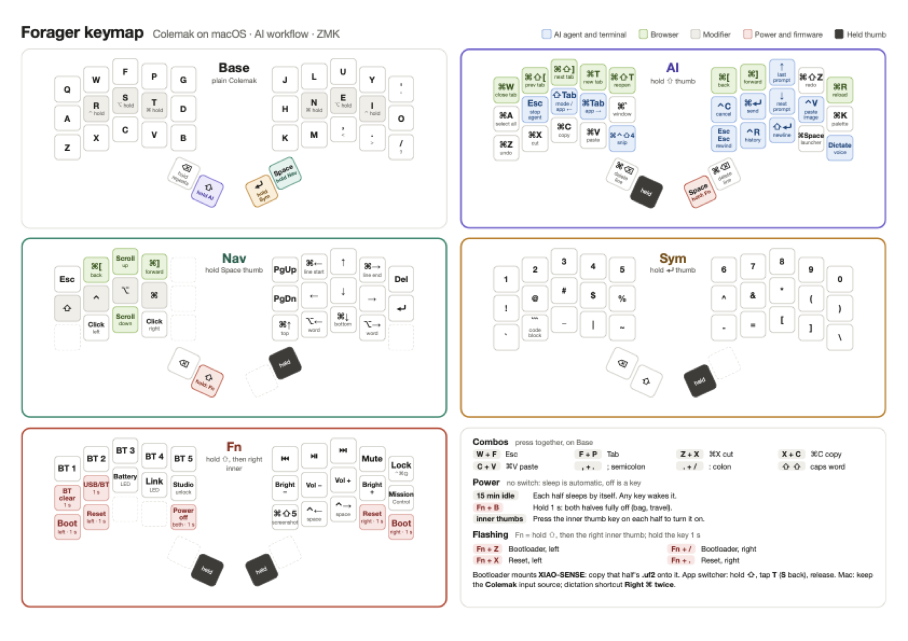

# Forager ZMK config

ZMK firmware for my [Forager](https://github.com/carrefinho/forager), forked from
[carrefinho/forager-zmk-module](https://github.com/carrefinho/forager-zmk-module).

- ZMK `main` from October 2026 (Zephyr 4.1), pinned by commit in `config/west.yml`
  and `.github/workflows/build.yml`. The board is now `xiao_ble//zmk`.
- Plain Colemak through the macOS Colemak input source: the keyboard sends QWERTY
  codes and macOS maps them, so keep the Mac on Colemak. `config/mac_colemak.h`
  maps each letter to the code that types it.
- Keymap tuned for AI agents in the terminal and the browser: `config/forager.keymap`.

## Cheat sheet

[](docs/forager_keymap_a4.pdf)

Printable A4 landscape PDF, in colour: [docs/forager_keymap_a4.pdf](docs/forager_keymap_a4.pdf).
After changing the keymap, update `docs/keymap_sheet.py` and regenerate it:

```sh
python3 docs/keymap_sheet.py
"/Applications/Google Chrome.app/Contents/MacOS/Google Chrome" --headless=new --no-pdf-header-footer \
  --print-to-pdf=docs/forager_keymap_a4.pdf "file://$PWD/docs/forager_keymap_a4.html"
```

## Layers

| Layer | How | What |
| --- | --- | --- |
| Base | — | Colemak, `'` top right, home-row ⌃ ⌥ ⌘ on R S T / N E I |
| Caps | tap the ⇧ thumb twice | caps word; Space, Enter or the ⇧ thumb ends it |
| Nav | hold Space | arrows, line/word jumps, page, scroll, clicks, held mods |
| Sym | hold Enter | digits, shifted digits, ``` ` ``` ``` `` ` `` ``` code fence, `_ \| ~ - = [ ] \` |
| AI | hold the ⇧ thumb (¼ s) | tabs, clipboard, ⌘Tab switcher, agent keys (Esc, ⇧Tab, ⌃C, ⌃V image, Esc Esc, ⌃R, ⇧⏎, ⌘⏎), dictation |
| Fn | hold ⇧, then the right inner thumb | Bluetooth, media, brightness, Mission Control, power, reset, bootloader |

Combos: W+F Esc, F+P Tab, Z+X cut, X+C copy, C+V paste, `,`+`.` `;`, `.`+`/` `:`.

Thumbs, left to right: ⌫ (hold repeats, ⇧⌫ deletes a word), ⇧ (tap for one
capital, hold for AI), Enter (hold for Sym), Space (hold for Nav). While AI is held
the right thumbs are Space (hold for Fn) and ⌘⌫ (delete line); so is the ⌫ key.

App switcher: hold the ⇧ thumb, tap T to step forward (S steps back), release
the thumb to switch.

Dictation key: set System Settings › Keyboard › Dictation › Shortcut to
"Press Right Command Key Twice".

## Power

The Forager has no power switch, and its reset buttons sit inside the case, so the
firmware handles power instead.

| State | How you get there | How you leave it | Battery use |
| --- | --- | --- | --- |
| Idle | 30 s without a key press | Any key, instantly | Low; Bluetooth stays connected |
| Deep sleep | 15 min without a key press, automatic | Any key; reconnects in a few seconds | Very low |
| Off (soft off) | Fn + B held 1 s; both halves go off | Inner thumb key on each half | Lowest, close to a real switch |

- Day to day you never need to do anything: walk away and the halves sleep on their own.
- Use **off** when the keyboard goes in a bag or won't be used for days. In deep
  sleep any squeezed key wakes it; when it's off only the inner thumb keys do.
- Fn = hold the ⇧ thumb, then hold the right inner thumb.

Reset and bootloader keys (Fn layer, hold 1 s): left half Z bootloader, X reset;
right half `/` bootloader, `.` reset. A right-half key only works while the two
halves are connected. If a half is unreachable, double-tap the XIAO reset button.
Bluetooth clear (Fn + A) and the USB/Bluetooth toggle (Fn + R) also need a 1 s hold.

After a firmware crash a half restarts by itself (`src/fatal_reboot.c`) instead of
freezing, since the reset buttons can't be reached in the case.

## Flashing

GitHub Actions builds `forager_left`, `forager_right` and `settings_reset` on every
push. Put a half in bootloader mode (Fn key above, or double-tap reset) and copy the
matching `.uf2` onto the `XIAO-SENSE` / `XIAO-BLE` drive.

ZMK Studio works over USB on the left half; it shows QWERTY key labels because of
the Colemak mapping above.
